# The Missing Map of AI Agents

## Volume 1: The Static Architecture

**Stephen Wang** | *System & Enterprise Architect*  
*October 2026 · First Edition · An Architect's Field Guide*  
*Born out of whiteboard discussions with engineering peers to build a shared map of the AI landscape*

---

## Contents at a Glance

- [Introduction: Why This Field Guide Exists](#introduction-why-this-field-guide-exists)
- [Chapter 1 — The Foundation: What Is an LLM?](#chapter-1--the-foundation-what-is-an-llm)
  - [Where LLMs Sit in the Bigger Picture](#where-llms-sit-in-the-bigger-picture)
  - [A Brief History: How We Got Here](#a-brief-history-how-we-got-here)
  - [An LLM Is Not Magic](#an-llm-is-not-magic)
  - [Why "Just Asking Questions" Has Limits](#why-just-asking-questions-has-limits)
- [Chapter 2 — The Agent: Making LLMs Useful](#chapter-2--the-agent-making-llms-useful)
  - [The Agent Equation](#the-agent-equation)
  - [Static View vs. Dynamic View](#static-view-vs-dynamic-view)
- [Chapter 3 — Context Engineering: Managing the Agent's Information](#chapter-3--context-engineering-managing-the-agents-information)
  - [3.1 Working Memory: Inside a Session](#31-working-memory-inside-a-session)
  - [3.2 Cross-Session Memory: Remembering Across Conversations](#32-cross-session-memory-remembering-across-conversations)
  - [3.3 External Factual Knowledge: Knowledge Bases & RAG](#33-external-factual-knowledge-knowledge-bases--rag)
  - [3.4 Actionable Procedural Knowledge: Skills](#34-actionable-procedural-knowledge-skills)
  - [3.5 Knowledge vs. Skills: Clarifying the Distinction](#35-knowledge-vs-skills-clarifying-the-distinction)
- [Chapter 4 — Tools and MCP: The Agent's Bridge to the Outside World](#chapter-4--tools-and-mcp-the-agents-bridge-to-the-outside-world)
  - [Giving the Model Hands and Eyes](#giving-the-model-hands-and-eyes)
  - [Standardizing the Interface: Model Context Protocol (MCP)](#standardizing-the-interface-model-context-protocol-mcp)
- [Chapter 5 — Harness Engineering: Putting It All Together](#chapter-5--harness-engineering-putting-it-all-together)
  - [The Upgraded Equation](#the-upgraded-equation)
  - [Why the Harness Matters](#why-the-harness-matters)
- [Chapter 6 — Synthesis: Putting the Buzzwords on the Map](#chapter-6--synthesis-putting-the-buzzwords-on-the-map)
- [Looking Ahead: Volume 2 Preview (The Runtime Engine)](#looking-ahead-volume-2-preview-the-runtime-engine)
- [Appendix: Quick Reference & Equations](#appendix-quick-reference--equations)
- [About the Author](#about-the-author)

---

<div style="page-break-after: always;"></div>

## Introduction: Why This Field Guide Exists

AI is currently full of buzzwords. Depending on which article, vendor announcement, YouTube video, or LinkedIn post you read, you will encounter terms like *AI agents*, *MCP*, *RAG*, *skills*, *prompt engineering*, *context engineering*, and dozens of others. 

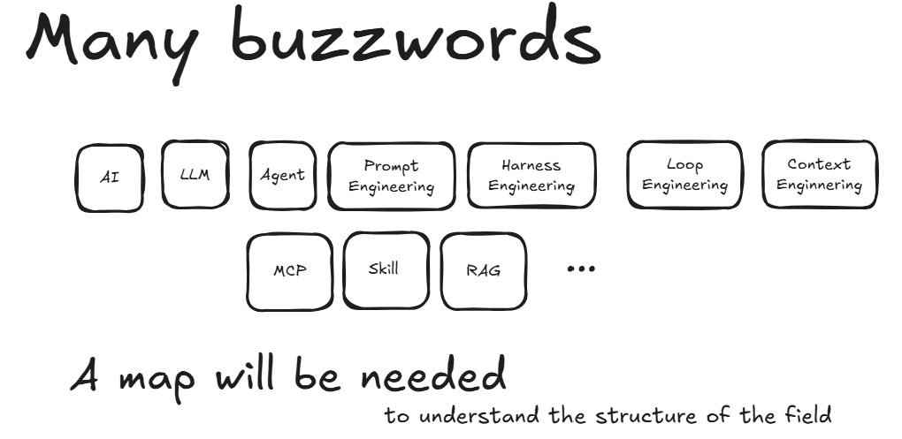

The problem is not that these concepts are difficult. The problem is that they are often presented **without a common map**.

This field guide is not about a specific tool or vendor framework. It is not about writing Python code or implementation details. Instead, it builds that map. It takes the major concepts, explains what each one means in plain systems-engineering terms, and — more importantly — shows how they fit together.

Think of this as learning the vocabulary and architectural structure of the field before you start designing or deploying systems.

By the end of this volume, you should understand:

- The key structural concepts behind modern AI agents
- How LLMs, context, memory, skills, tools, and harnesses connect together
- A solid foundation for evaluating agent architectures in enterprise and production settings

---

<div style="page-break-after: always;"></div>

## Chapter 1 — The Foundation: What Is an LLM?

> **Chapter Thesis:** An LLM is not magic. It is a relatively small inference program reading a very large parameter file. It cannot proactively learn or act; it is a stateless reasoning engine waiting for context.

### Where LLMs Sit in the Bigger Picture

Before we talk about agents, we need to understand what powers them. There are a lot of terms floating around, and they nest inside each other like Russian dolls:

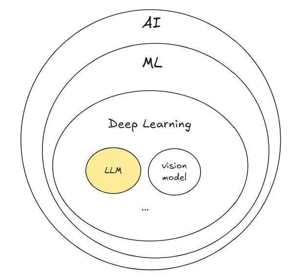

- **AI (Artificial Intelligence)** — covers all forms of machine intelligence. The broadest umbrella.
- **ML (Machine Learning)** — a subset of AI that learns from data and patterns rather than being explicitly programmed with rigid rules.
- **Deep Learning** — a further subset of ML that uses multi-layer neural networks. The breakthrough that made modern computer vision, speech, and language models practical.
- **LLM (Large Language Model)** — a specialized deep learning model trained on vast text corpora that powers today's most popular AI tools. This is what ChatGPT, Copilot, Claude, and Gemini run on.

When people say "AI" in 2026, they usually mean LLMs. But keeping the family tree in mind helps prevent conceptual confusion.

### A Brief History: How We Got Here

The modern LLM wave traces back to a single research paper: **"Attention Is All You Need"**, published by Google researchers in 2017. It introduced the **Transformer** architecture.

Why did Transformers change everything? Three forces converged:

1. **Parallelism** — unlike earlier sequential architectures (RNNs, LSTMs), Transformers process entire text sequences in parallel. This made training dramatically faster.
2. **Scalability** — the architecture scales predictably with compute. More GPUs, more parameters, and more training tokens consistently yield superior reasoning.
3. **Data availability** — the public internet provided billions of high-quality documents and code repositories to train on.

These three factors — architecture + compute + data — produced the foundation models we use today.

### An LLM Is Not Magic

Strip away the marketing, and an LLM is essentially two components:

| Component | What It Is | Example (LLaMA 2 70B) |
|---|---|---|
| **Inference program** | A relatively small piece of code (the Transformer implementation) | `run.c` — roughly 500 lines of C |
| **Parameter file** | A very large file containing billions of learned weights | `weights` — approximately 140 GB |

During pre-training, billions of floating-point parameters are adjusted to capture language grammar, factual knowledge, coding patterns, and reasoning behaviors. At runtime, the code remains fixed while the learned parameters provide the model's capabilities.

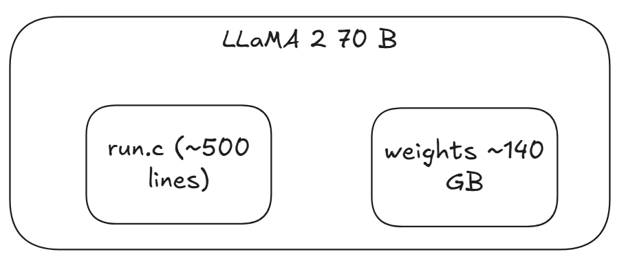

### Why "Just Asking Questions" Has Limits

If you interact with a bare LLM, the interaction pattern is single-shot: you ask, it answers. One prompt in, one completion out.

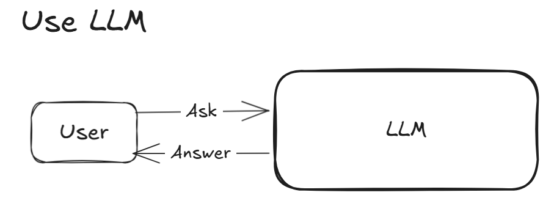

The quality of the answer depends heavily on the clarity of the question. The model acts like a mirror: it reflects the precision (or ambiguity) of your input. If you structure your request well, the model can produce a strong answer.

This gave rise to the first popular discipline: **Prompt Engineering** — the art of refining natural-language instructions to improve model output quality.

However, even if the model possesses encyclopedic knowledge, a pure question-and-answer exchange has severe limitations in real-world systems. In a software organization, you do not just want text answers. You want the system to inspect code, commit to GitHub, run tests, query production databases, or operate web applications.

That fundamental limitation is why we must move from bare LLMs to **AI Agents**.

---

<div style="page-break-after: always;"></div>

## Chapter 2 — The Agent: Making LLMs Useful

> **Chapter Thesis:** `Agent = LLM + Context + Tools`. An LLM is a reasoning engine; Context gives it perception and memory; Tools give it the ability to act on the world.

### The Agent Equation

If the LLM is a brain in a jar — capable of deep reasoning but completely disconnected from reality — the agent is what gives it sensory organs and hands.

> **Agent = LLM + Context + Tools**

This is the central equation of modern AI engineering. Every agent framework, product, and protocol is an implementation of these three components.

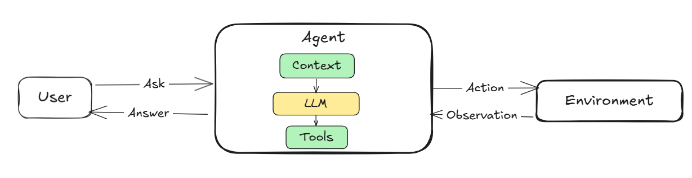

- **LLM** provides the general reasoning, pattern matching, and decision-making engine.
- **Context** provides the working set of information: instructions, immediate task goals, past conversation history, relevant facts, and current environment state.
- **Tools** provide the ability to execute actions in the external digital environment (file systems, APIs, browsers, databases).

Together, they transform a passive text generator into an active system capable of accomplishing real-world goals.

### Static View vs. Dynamic View

In software architecture, complex systems are understood through two complementary lenses:

- **The Static View (What is it made of?)** — The structural components, boundaries, and information flows: the LLM, context window, memory stores, skill packages, tool interfaces, and the harness.
- **The Dynamic View (How does it run?)** — The runtime behavior: function calling, reasoning loops (ReAct), multi-step planning, self-correction, and enterprise guardrails.

This volume focuses entirely on the **Static View**. Once you master the structural map, understanding runtime loops becomes straightforward.

---

<div style="page-break-after: always;"></div>

## Chapter 3 — Context Engineering: Managing the Agent's Information

> **Chapter Thesis:** Prompt engineering is about phrasing a question; Context Engineering is the discipline of architecting all information entering the model — across active sessions, long-term memory, factual knowledge bases, and on-demand skills.

An LLM cannot independently explore your enterprise network or remember what happened after its training cutoff date. Every piece of information it reasons about must enter through a single channel: its **context**.

Context Engineering is the information manager inside the agent. It coordinates four foundational layers:

1. **Working Memory (Session Context)** — the active conversation history, instructions, and environment status.
2. **Cross-Session Memory** — durable user preferences and project facts retained across separate conversations.
3. **External Factual Knowledge (Knowledge Bases & RAG)** — what the agent needs to *know*.
4. **Actionable Procedural Knowledge (Skills)** — what the agent needs to *do*.

Let's examine each layer.

---

### 3.1 Working Memory: Inside a Session

#### Everything Starts with the Session
When you interact with an agent over multiple turns, you ask a question, receive an answer, clarify your request, and iterate.

Here is what actually occurs under the hood:

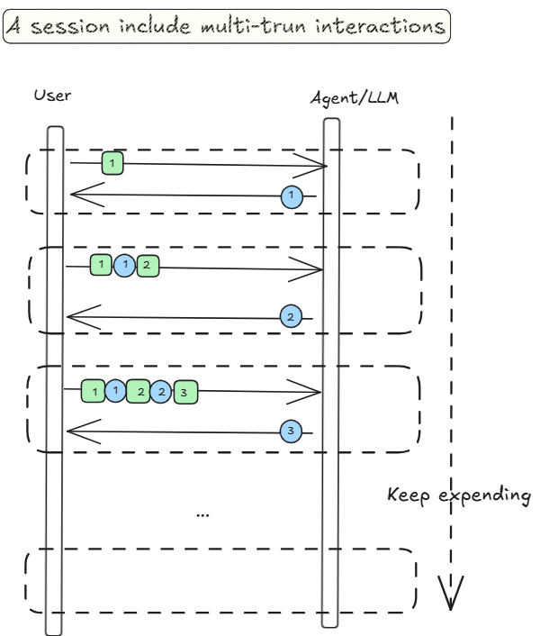

- **Round 1:** You send Question 1. The model generates Answer 1.
- **Round 2:** You ask a follow-up. Because the underlying model is completely stateless, the agent framework appends *Question 1 + Answer 1 + Question 2* into a single combined block and sends it to the model.
- **Round 3:** The history continues to grow: *Q1 + A1 + Q2 + A2 + Q3*. The full accumulated trajectory is resent on every single round.

This explains the well-known industry story: *"Never type 'Thanks' at the end of a long agent session."* If your conversation has been going on for a while and you type *"Thanks"*, that single polite word forces the system to resend that entire accumulated history. The model consumes GPU compute processing the whole payload just to output *"You're welcome!"*

In modern agent tools, this history concatenation is handled automatically, but understanding the cost and attention implications is critical for system architects.

#### The Context Window: The Hard Boundary
All information supplied to the model must fit inside its **context window** — the maximum token limit a model can process in one invocation.

While modern cloud models support context windows from 128k to 1M+ tokens, context is a finite resource. Accumulating transcripts, multi-file codebases, documentation chunks, and intermediate tool results consumes space rapidly.

#### Compression: When the Window Fills Up
When session history approaches the context window limit, the agent framework must **compress** or summarize older turns. 

Compression introduces engineering trade-offs: aggressive summarization dilutes nuance and can cause the model to lose track of subtle constraints set early in the session.

> **Architect's Tip:** Keep agent sessions single-purpose. When a session begins to wander or degrade, start a clean session and carry over only a crisp summary of previous decisions.

#### The Structured Context Stack
If you inspect the actual payload delivered into the model's context window, you will find a distinct, layered architecture:

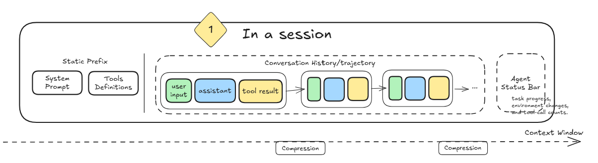

- **System Prompt (Static Prefix):** Foundational instructions defining who the agent is, its role, operational boundaries, and formatting rules.
- **Tool Definitions (Static Prefix):** Machine-readable schemas (names, parameters, descriptions) of all functions the agent is allowed to invoke.
- **Conversation History (Dynamic Trajectory):** The chronological sequence of user messages, assistant responses, and tool execution results.
- **Agent Status Bar (Dynamic State):** Structured runtime metadata injected by the framework (task progress, environment changes, tool-call budgets) to keep the model grounded in current reality.

---

### 3.2 Cross-Session Memory: Remembering Across Conversations

Within a single session, state is preserved by appending history. But what happens tomorrow when you start a new chat?

Without dedicated memory architecture, every new session starts with total amnesia.

Advanced agent systems address this through **User Memory / Cross-Session Memory**:
1. At the end of a session, an extraction pipeline identifies durable facts (e.g., *"Stephen prefers TypeScript over JavaScript"*, *"The production database uses port 5432"*).
2. These facts are stored in a persistent memory repository.
3. In subsequent sessions, relevant memories are retrieved and injected into the initial system prompt, giving the agent continuity across time.

---

### 3.3 External Factual Knowledge: Knowledge Bases & RAG

#### The Knowledge Gap
A pre-trained foundation model possesses broad world knowledge, but it knows nothing about:
- Your organization's proprietary architecture blueprints
- Internal Confluence pages, Jira tickets, and private repositories
- Recent company updates post-training cutoff

To ground the agent in private, up-to-date facts, we introduce a **Knowledge Base** paired with **RAG (Retrieval-Augmented Generation)**.

#### How RAG Works
RAG provides the agent with an on-demand retrieval pipeline:

- The user asks a question.
- The system searches external knowledge repositories (documents, vector databases, code indices).
- Relevant snippets are retrieved based on semantic similarity.
- The retrieved snippets are merged with the user's prompt to assemble an augmented context.
- The model generates an answer strictly grounded in the supplied snippets.

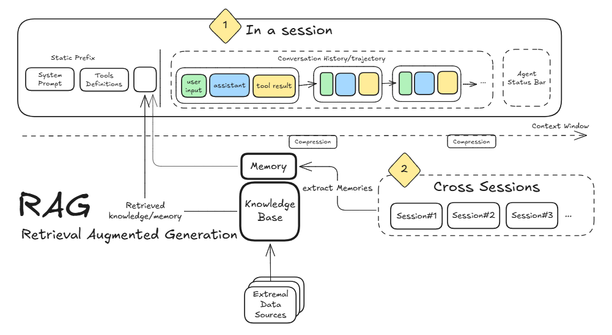

> **Core Insight:** RAG uses the context window as a dynamic briefing channel. You do not need to retrain or fine-tune weights; you simply provide the right facts at the precise moment of reasoning.

---

### 3.4 Actionable Procedural Knowledge: Skills

#### The Problem with Giant System Prompts
As agents are assigned more responsibilities, teams often try to pack every conceivable procedure into a massive system prompt:
- This **wastes expensive tokens** on instructions irrelevant to the current turn.
- It **dilutes attention**, causing the model to miss or confuse critical rules.

This problem led directly to the development of **Agent Skills**: modular, on-demand packages of procedural knowledge loaded into context only when needed.

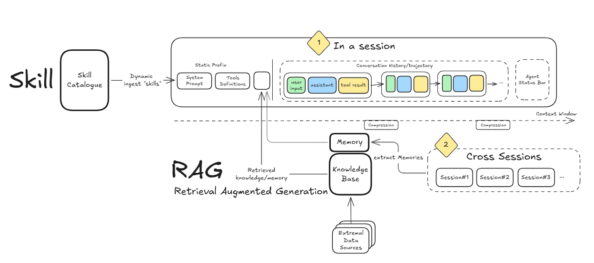

#### Anatomy of a Skill
A skill is a self-contained, version-controlled module (often starting as a clear Markdown specification) containing:
- **A Trigger Description:** Clear natural-language definitions of when and why this skill should activate.
- **Actionable Workflows:** Step-by-step guidance on how an expert approaches the task.
- **Constraints & Edge Cases:** Explicit boundaries and verification criteria.
- **Templates & Code Scripts:** Reference artifacts or helper scripts.

For example, an *Architecture Review Skill* codifies the exact checklist, trade-off evaluations, and diagram standards an experienced enterprise architect uses when reviewing a system proposal.

#### Progressive Disclosure
Rather than bloating the prompt with every skill's full text, the agent maintains only lightweight catalog descriptions in its initial prompt.

When the user's request matches a specific skill, the agent dynamically pulls the full procedure into the context window on the fly. This mechanism — **Progressive Disclosure** — keeps baseline token consumption minimal while providing deep operational expertise when needed.

#### Real-World Example: Computer Use
Consider a **Computer Use Skill**. An LLM does not natively know how to operate a graphical operating system.

Equipping it with a computer use skill provides a concrete loop: take a screenshot, parse visual UI elements into coordinate bounding boxes, generate mouse clicks or keystrokes, and observe the resulting state. By loading this procedural skill, the agent transforms from a chatbot into a hands-on operator.

---

### 3.5 Knowledge vs. Skills: Clarifying the Distinction

A frequent point of confusion is: *"If both are stored as Markdown or text files, what is the difference between a Knowledge Base and a Skill?"*

Their architectural purpose is fundamentally distinct:

| Dimension | Knowledge Base (RAG) | Skill |
|---|---|---|
| **What it contains** | Facts, reference documentation, specifications | Workflows, procedures, decision checklists |
| **Question it answers** | *What is the truth?* | *How should this task be executed?* |
| **Cognitive Analogy** | Semantic Memory (an encyclopedia or manual) | Procedural Memory (a recipe or operational playbook) |
| **Access Pattern** | Retrieved semantically via similarity search | Loaded on demand when the task scenario matches |

---

<div style="page-break-after: always;"></div>

## Chapter 4 — Tools and MCP: The Agent's Bridge to the Outside World

> **Chapter Thesis:** Context gives the model information; Tools give it agency. Model Context Protocol (MCP) standardizes this connection, acting as the universal USB standard for AI integrations.

### Giving the Model Hands and Eyes

Without tools, an LLM is purely conversational. It can suggest code, but cannot test it. It can propose a SQL query, but cannot execute it.

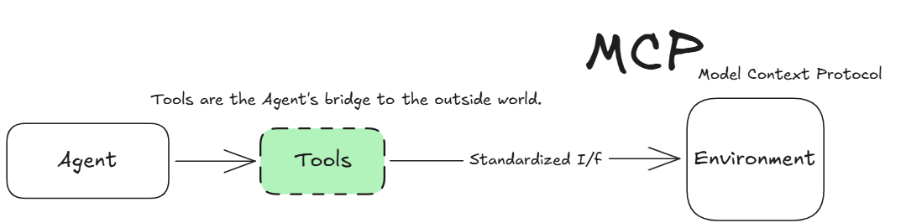

Tools turn the agent from a passive observer into an active participant capable of modifying external digital state:

- **File System Tools:** Searching, reading, modifying, and creating files.
- **Terminal & Shell Tools:** Executing build scripts, running test suites, managing git branches.
- **Browser Automation:** Navigating web portals, interacting with forms, scraping web data.
- **Enterprise APIs & Databases:** Querying live services, posting tickets, updating records.

*(Note: The runtime mechanics of how the model analyzes tool schemas, emits structured arguments, and pauses execution belong to the dynamic runtime view — covered in detail in Part 2 of this series under **Function Calling & Agent Loops**.)*

### Standardizing the Interface: Model Context Protocol (MCP)

In the early days of agent development, connecting an agent to an external system required custom, point-to-point integration code. If you had 4 different agent frameworks and 10 internal databases or tools, you had to maintain 40 fragile connectors.

**Model Context Protocol (MCP)** standardizes this interface across the ecosystem.

Much like **USB** eliminated proprietary cables by defining a universal hardware interface, MCP establishes an open protocol for how any AI agent discovers, authenticates, and communicates with tool servers and data sources. Whether you are exposing Jira, GitHub, a local PostgreSQL instance, or custom internal microservices, an MCP-compliant tool server plugs into any MCP-compliant agent out of the box.

---

<div style="page-break-after: always;"></div>

## Chapter 5 — Harness Engineering: Putting It All Together

> **Chapter Thesis:** `Agent = LLM + Harness`. Foundation models are becoming commoditized; the real competitive advantage and production reliability lie in the quality of the software harness built around the model.

### The Upgraded Equation

We began in Chapter 2 with our initial definition:

> **Agent = LLM + Context + Tools**

As we have explored throughout this guide, managing context and tools at scale involves significant systems engineering: context budgeting, session compression, cross-session memory stores, hybrid RAG pipelines, dynamic skill dispatching, and secure MCP protocol adapters.

Because of this architectural complexity, modern AI engineering reframes the equation:

> **Agent = LLM + Harness**

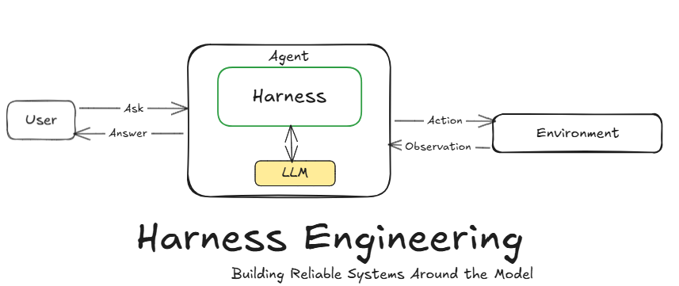

The **Harness** is the comprehensive software infrastructure built around the raw model. It encompasses:
- Context and memory management pipelines
- Tool registries and protocol adapters (such as MCP)
- Skill catalogues and progressive disclosure engines
- Reliability layers, retry logic, and safety guardrails
- State persistence and session management across executions

### Why the Harness Matters

The underlying foundation models are increasingly accessible and standardized. Two competing enterprises can license the exact same frontier model via an API.

What determines whether an agent is an unreliable toy or an enterprise-grade production asset is **the engineering quality of its harness**. 

Harness Engineering is the disciplined craft of wrapping a probabilistic reasoning engine in deterministic, observable, and secure software architecture.

---

<div style="page-break-after: always;"></div>

## Chapter 6 — Synthesis: Putting the Buzzwords on the Map

Throughout this field guide, we have deconstructed the sprawling landscape of AI terminology into a cohesive static architecture. 

Here is where the major concepts sit on our architectural map:

| Buzzword | Where It Sits on the Map | Core Architectural Role |
|---|---|---|
| **Prompt Engineering** | Inside Context | Crafting instructions and queries to elicit optimal answers |
| **Context Window** | Inside Context | The physical token boundary of a model invocation |
| **Context Engineering** | Overarching Discipline | Architecting the entire information flow (working memory, RAG, skills) |
| **RAG** | Context (Knowledge Layer) | Bringing external, private facts into the model's working window |
| **Skills** | Context (Procedural Layer) | Modular, on-demand expert workflows loaded via progressive disclosure |
| **Tools** | Action Layer | External capabilities (file system, browser, APIs) that affect the world |
| **MCP** | Action Layer | The open standard protocol for plugging tools into any agent |
| **Harness Engineering** | Entire Agent System | Engineering the complete software infrastructure surrounding the LLM |

---

<div style="page-break-after: always;"></div>

## Looking Ahead: Volume 2 Preview (The Runtime Engine)

This volume focused on the **Static View** — the structural elements that make up an agent before it runs.

In production, an agent does not sit idle. It executes across time, makes mistakes, self-corrects, and interacts with complex enterprise systems.

**Volume 2: The Runtime Engine** will explore the **Dynamic View**:

- **Function Calling & Schema Validation:** The exact protocol where the model inspects tool definitions, outputs structured JSON arguments, and parses execution outputs.
- **The ReAct Pattern (Reason + Act):** The interleaved loop of Thought (reasoning), Action (tool execution), and Observation (inspecting environment feedback).
- **The Agent Loop:** Autonomous execution state machines that iterate until verifiable completion criteria are met.
- **Loop Engineering:** Moving from manual, interactive human chat to unattended, scheduled, self-healing background loops.
- **The Enterprise Harness:** Verification gates, sandboxed execution, audit trails, and security trust boundaries at scale.

These runtime systems build directly upon the static architecture established in this field guide.

---

<div style="page-break-after: always;"></div>

## Appendix: Quick Reference & Equations

### The Core Architectural Equations

```
LLM = Inference Code + Parameters (Weights)

Agent = LLM + Context + Tools

Agent = LLM + Harness

Harness = Context Management + Tool Interfaces + Reliability & Guardrails
```

### The Nested AI Hierarchy

```
AI ⊃ Machine Learning ⊃ Deep Learning ⊃ LLMs
```

### The Structured Context Stack

```
┌────────────────────────────────────────────────────────┐
│  Working Session Context (System Prompt + Tool Schemas)│
├────────────────────────────────────────────────────────┤
│  Dynamic Additions: RAG (Facts) + Skills (Workflows)   │
├────────────────────────────────────────────────────────┤
│  Conversation History & Tool Results                   │
├────────────────────────────────────────────────────────┤
│  Agent Status Bar & Runtime State                      │
└────────────────────────────────────────────────────────┘
```

---

<div style="page-break-after: always;"></div>

## Further Reading

- **"Attention Is All You Need"** (Vaswani et al., 2017) — Google Research paper introducing the Transformer architecture.
- **Anthropic Agent Skills Specification** — Industry standard for packaging modular agent workflows.
- **Model Context Protocol (MCP) Specification** — Open protocol for universal tool and data integration.
- **ReAct: Synergizing Reasoning and Acting in Language Models** (Yao et al., 2022) — Foundational paper on multi-turn reasoning and tool execution loops.

---

<div style="page-break-after: always;"></div>

## About the Author

**Stephen Wang** is a software and enterprise systems architect with over 20 years of experience designing mission-critical architectures across enterprise platforms, autonomous-driving computer vision systems, and modern AI-native applications. 

He writes regularly on LinkedIn about the architectural transition from traditional deterministic systems to probabilistic AI agent loops, focusing on systems engineering, verification, and enterprise harness design.

---

*The Missing Map of AI Agents — Volume 1: The Static Architecture. Published for open reference and sharing.*
